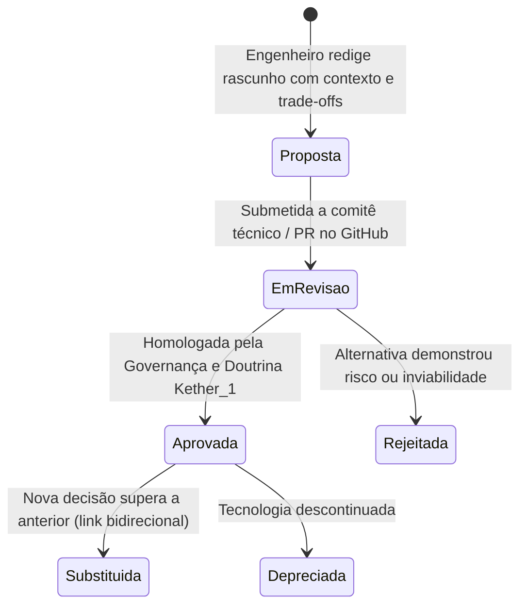

# 🏛️ Techdim Architecture Decision Records (ADRs)
## Repositório Central de Registros de Decisão de Arquitetura, Governança Técnica & Diagramas de Engenharia


[](https://techdimbr.github.io/techdimbr/)
[](https://www.techdim.com.br)
[](https://cognitect.com)
[](https://mermaid.js.org)
[](README.md)
[](LICENSE)

> **Repositório oficial de Registros de Decisão de Arquitetura (ADRs) da TECHDIM. Registra o racional técnico, trade-offs de engenharia, escolhas de ciberdefesa e especificações de conformidade com histórico imutável versionado via Git.**

---

## 🏛️ Visão Geral & Proposta de Valor

Em projetos corporativos de grande porte, decisões críticas de arquitetura (ex.: migração de protocolo, escolha de banco de dados, política de isolamento) são frequentemente tomadas em reuniões verbais e esquecidas ao longo do tempo. Quando um novo engenheiro ou auditor questiona o motivo de uma escolha, ninguém sabe explicar.

Os **Architecture Decision Records (ADRs)** resolvem isso de forma definitiva:
1. **Rastreabilidade e Memória Técnica:** Cada decisão tecnológica relevante recebe um documento atômico (`ADR-XXX`) com contexto, alternativas avaliadas, justificativa e consequências.
2. **Trade-offs Transparentes:** Deixa explícito o que a arquitetura ganha (ex.: segurança, integridade matemática) e o que abre mão (ex.: facilidade imediata, configurações manuais ad-hoc).
3. **Diagramas Visuais Vivos:** Utiliza Mermaid diretamente nos arquivos Markdown, renderizados nativamente pelo GitHub sem necessidade de imagens estáticas desatualizadas.

---

## 🏗️ Ciclo de Vida de uma Decisão de Arquitetura



---

## ⚡ Início Rápido

### Comandos de Validação e Auditoria de ADRs
```bash
# 1. Clonar o repositório
git clone https://github.com/Techdimbr/techdim-architecture-decision-records.git
cd techdim-architecture-decision-records

# 2. Inicializar o ambiente local
./iniciar.sh

# 3. Executar o linter de conformidade de ADRs
python3 03_APLICACAO/src/adr_linter.py
```

---

## 🛡️ Governança & Contato Corporativo
- **Autor:** Deivis Írio Mayer (Kether_1)
- **Entidade:** TECHDIM INOVA SIMPLES (I.S.) - ME · CNPJ 61.933.926/0001-24
- **Website Oficial:** [https://www.techdim.com.br](https://www.techdim.com.br)
- **Portal de Soluções:** [https://techdimbr.github.io/techdimbr/](https://techdimbr.github.io/techdimbr/)
